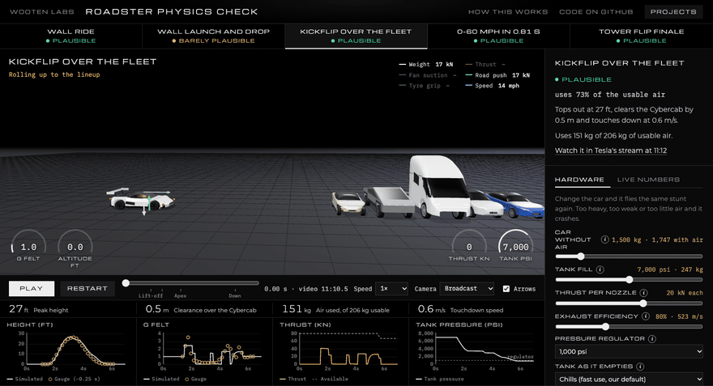
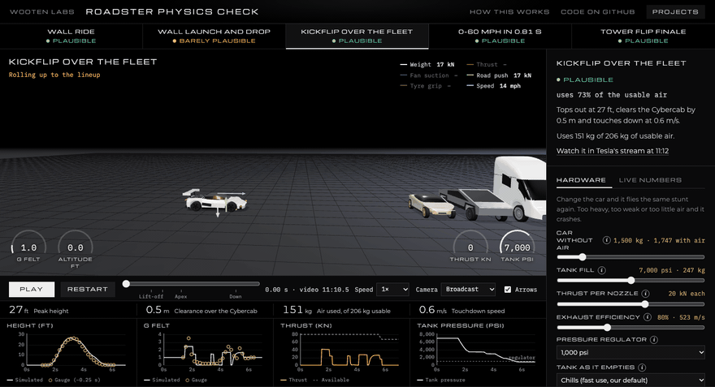

# Roadster Physics Check

**Could Tesla's flying Roadster actually do those stunts on 600 litres of compressed air?**

**[Try it live →](https://wooten-labs.com/roadster/)**

Each stunt from Tesla's October 15, 2026 Roadster reveal, rebuilt as a physics simulation that runs in your browser. We read the on-screen telemetry off Tesla's stream frame by frame. Each stunt became a program for a simple flight computer, and the car flies that program as a rigid body with 10 thrusters, a real-gas nitrogen tank, fan suction and tyre grip. Every assumption is a dial. Get the hardware wrong and the car crashes.



*The kickflip at our best-estimate hardware. It clears the parked cars and lands at 0.6 m/s with 27% of its usable air to spare. The gold dots on the charts are the broadcast's own gauge readings.*



*The same flight program with the car made heavier (2,600 kg plus air). It runs out of air on the way down and hits the road at 6.3 m/s.*

## What we found

At the hardware Tesla described (about 250 kg of nitrogen in 600 L, which takes about 7,000 psi, and 20 kN per nozzle), with the car at about 1,750 kg at take-off:

| Stunt | Verdict | Deciding fact |
|---|---|---|
| Wall ride | Plausible | 1.9× the fan suction it needs |
| Wall launch and drop | Barely plausible | uses 93% of the usable air |
| Kickflip over the fleet | Plausible | uses 73% of the usable air |
| 0–60 mph in 0.81 s | Plausible | uses 31% of the rear thrust |
| Tower flip finale | Plausible | uses 54% of the usable air |

The margins are thin and depend on a few unknowns:

- **Weight.** Tesla's "just under 1,700 kilos" doesn't say whether the air is included. If it isn't, the take-off weight is about 1,950 kg. At 2,100 kg the drop fails; at 2,300 kg the kickflip runs out of air too.
- **Stiff fan skirts.** The wall ride assumes skirts that flex to follow the curved ramp. With stiff ones, the gap under the middle of the car would be about 8 cm, and 80 kW of fans couldn't hold it.
- **Air quality.** Nozzle efficiency, the regulator and how cold the tank gets all move the gas budget by 20–30%.

This can't tell you whether the footage is real, only whether the motion it shows is physically possible with the hardware Tesla described.

## Check our work

- **[docs/METHODS.md](docs/METHODS.md)**: every equation, constant and assumption, with sources.
- **[docs/RESULTS.md](docs/RESULTS.md)**: the numbers, the simulation compared with the video's gauges, and every dial swept across its range.
- **Reproduce it** with Node 18 or later and no dependencies:

  ```
  node scripts/roadster_check.mjs
  ```

  It runs the same `physics.js` the page uses and prints RESULTS.md.

The core of it, in brief:

```math
m\,\dot{\mathbf v} = R(q)\,\mathbf F_{\text{nozzles}} - m g\,\hat{\mathbf y}, \qquad I\,\dot{\boldsymbol\omega} = \mathbf M_{\text{nozzles}} - \boldsymbol\omega \times (I\boldsymbol\omega + \mathbf H_{\text{wheels}})
```

```math
v_e = \eta\sqrt{2c_pT\left[1 - (p_a/p_0)^{(\gamma-1)/\gamma}\right]}, \qquad \dot m = F/v_e
```

The tank's pressure and temperature as it empties come from CoolProp's real-gas nitrogen tables, not the ideal-gas law. The flight computer only ever sees the thrust it has right now, so a weaker or heavier car has to brake earlier and burns more gas.

Found a mistake? Please [open an issue](https://github.com/jonclegg/roadster-physics-check/issues). The most useful kind names the line in `physics.js` and the number you'd use instead.

## Run it locally

It's a static page with no build step:

```
cd site/roadster
python3 -m http.server 8000
```

Then open http://localhost:8000. three.js loads from jsDelivr.

To regenerate the tank tables (needs [CoolProp](http://www.coolprop.org/)):

```
pip install CoolProp
python3 scripts/roadster_tank_tables.py
```

## Files

| Path | What it is |
|---|---|
| `site/roadster/physics.js` | The simulation. Pure functions, no DOM: tank blowdown, nozzle allocation, rigid-body flight at 240 Hz, the wall-ride force balance and the verdicts |
| `site/roadster/app.js` | The three.js scene, playback, gauges, charts and dials |
| `site/roadster/models.js` | Procedural vehicle models |
| `site/roadster/tank-tables.js` | Generated real-gas nitrogen tables. Don't edit it by hand. |
| `scripts/roadster_check.mjs` | Runs every stunt in Node and prints the results |
| `scripts/roadster_tank_tables.py` | Regenerates the tank tables with CoolProp |
| `media/` | The GIFs above, plus MP4 versions |

## Licence

The code is MIT (see `LICENSE`), except `site/roadster/models.js`. Its vehicle outlines are traced from Wikimedia Commons photos, so it is shared under [CC BY-SA 4.0](https://creativecommons.org/licenses/by-sa/4.0/):

- [Model 3](https://commons.wikimedia.org/wiki/File:Tesla_Model_3_(2023),_long_range,_Japan,_left-side.jpg) by Kazyakuruma (CC0)
- [Cybercab](https://commons.wikimedia.org/wiki/File:Tesla_Cybercab_at_Santana_Row_side_view_dllu.jpg) by Dllu (CC BY-SA 4.0)
- [Semi render](https://commons.wikimedia.org/wiki/File:Tesla_Semi_Render.svg) by Jzh2074 (CC BY-SA 4.0)
- [Cybertruck](https://commons.wikimedia.org/wiki/File:Tesla_Cybertruck_-_Side_-_Tesla_Store_Athens_2024.jpg) by Mpelas199 (CC0)

The Roadster's shape is our own, estimated from Tesla's livestream.

Not affiliated with, or endorsed by, Tesla or SpaceX.
